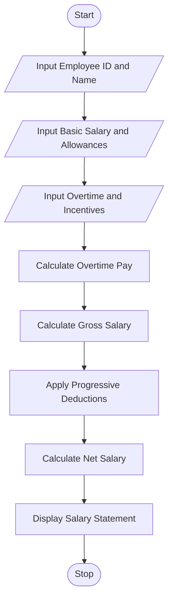

Title
Employee Payroll and Deduction Analysis Using Python
 Aim
To develop a Python program to calculate gross salary
using basic pay, allowances, overtime and incentives,
apply progressive deductions and generate a salary statement.

 Problem Statement
Develop a Python program that accepts employee details
and salary components, calculates gross salary, applies
progressive deductions and calculates net salary.

Algorithm

1. Start the program.
2. Read employee ID and employee name.
3. Enter basic salary.
4. Enter allowances, overtime hours and overtime rate.
5. Enter incentives.
6. Calculate overtime payment.
7. Calculate gross salary.
8. Calculate deductions using progressive slabs.
9. Calculate net salary.
10. Display the formatted salary statement.
11. Stop the program.

 Flowchart



 Progressive Deduction Slabs

| Gross Salary | Deduction Rate |
|---|---|
| First Rs. 20,000 | 5% |
| Next Rs. 20,000 | 10% |
| Above Rs. 40,000 | 15% |

Note: These are assumed rates for educational purposes.

Sample Input

```text
Enter Employee ID: E101
Enter Employee Name: Rahul
Enter Basic Salary: 25000
Enter Allowances: 5000
Enter Overtime Hours: 10
Enter Overtime Rate: 200
Enter Incentives: 3000
```

Sample Output

```text
======================================
       EMPLOYEE SALARY STATEMENT
======================================
Employee ID       : E101
Employee Name     : Rahul
--------------------------------------
Basic Salary      : Rs. 25000.0
Allowances        : Rs. 5000.0
Overtime Pay      : Rs. 2000.0
Incentives        : Rs. 3000.0
--------------------------------------
Gross Salary      : Rs. 35000.0
Total Deductions  : Rs. 2500.0
--------------------------------------
NET SALARY        : Rs. 32500.0
======================================
       PAYROLL COMPLETED
```

 Result
The program successfully calculates gross salary,
applies progressive deductions and generates the
employee salary statement.

Conclusion
This activity demonstrates the use of Python variables,
functions, conditional statements and arithmetic
operations in a real-world payroll management system.
7. What is the purpose of if-elif-else statements?

