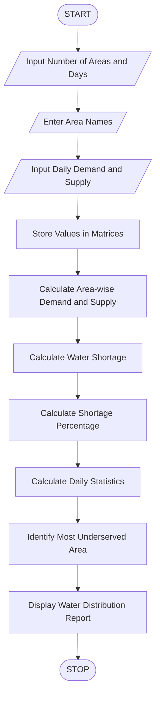

 Title
Water Distribution Fairness Analysis Using Python

 1. Aim
To develop a Python program to analyse area-wise water
supply across several days, calculate shortages against
demand, compare distribution levels, and identify the
most underserved areas.

2. Problem Statement
A city supplies water to different residential areas
every day. Each area has a specific daily water demand
and receives a certain quantity of water.

The program calculates area-wise total demand and
supply, water shortages, shortage percentages, daily
distribution statistics, and identifies the most
underserved area.

3. Algorithm

1. Start the program.
2. Enter the number of areas and days.
3. Enter the names of all areas.
4. Input daily water demand for each area.
5. Input actual water supply for each area.
6. Store readings in two-dimensional matrices.
7. Calculate area-wise total demand.
8. Calculate area-wise total supply.
9. Calculate water shortage for each area.
10. Calculate shortage percentage.
11. Calculate daily total demand and supply.
12. Identify the most underserved area.
13. Display the water distribution report.
14. Stop the program.

4. Flowchart



5. Formulae Used

Total Demand = Sum of Daily Water Demand

Total Supply = Sum of Daily Water Supply

Water Shortage = Maximum of (0, Total Demand - Total Supply)

Shortage Percentage =
(Water Shortage / Total Demand) * 100

Most Underserved Area =
Area with Highest Shortage Percentage

 6. Sample Input

```text
Enter Number of Areas: 3
Enter Number of Days: 3

Enter Area Name: Area A
Enter Area Name: Area B
Enter Area Name: Area C

Area: Area A
Day 1
Enter Water Demand (litres): 1000
Enter Water Supply (litres): 900
Day 2
Enter Water Demand (litres): 1000
Enter Water Supply (litres): 800
Day 3
Enter Water Demand (litres): 1000
Enter Water Supply (litres): 850

Area: Area B
Day 1
Enter Water Demand (litres): 1200
Enter Water Supply (litres): 1100
Day 2
Enter Water Demand (litres): 1200
Enter Water Supply (litres): 1000
Day 3
Enter Water Demand (litres): 1200
Enter Water Supply (litres): 1100

Area: Area C
Day 1
Enter Water Demand (litres): 800
Enter Water Supply (litres): 500
Day 2
Enter Water Demand (litres): 800
Enter Water Supply (litres): 400
Day 3
Enter Water Demand (litres): 800
Enter Water Supply (litres): 450
```

 7. Sample Output

```text
======================================
 WATER DISTRIBUTION FAIRNESS REPORT
======================================

AREA-WISE ANALYSIS

Area: Area A
Total Demand: 3000.0 litres
Total Supply: 2550.0 litres
Water Shortage: 450.0 litres
Shortage Percentage: 15.0 %

Area: Area B
Total Demand: 3600.0 litres
Total Supply: 3200.0 litres
Water Shortage: 400.0 litres
Shortage Percentage: 11.11 %

Area: Area C
Total Demand: 2400.0 litres
Total Supply: 1350.0 litres
Water Shortage: 1050.0 litres
Shortage Percentage: 43.75 %

DAILY WATER DISTRIBUTION

Day 1
Total Demand: 3000.0 litres
Total Supply: 2500.0 litres
Total Shortage: 500.0 litres

Day 2
Total Demand: 3000.0 litres
Total Supply: 2200.0 litres
Total Shortage: 800.0 litres

Day 3
Total Demand: 3000.0 litres
Total Supply: 2400.0 litres
Total Shortage: 600.0 litres

MOST UNDERSERVED AREA(S):
Area C - Shortage: 43.75 %

======================================
 ANALYSIS COMPLETED
======================================
```

 8. Result
The Python program successfully analyses area-wise
water demand and supply across multiple days, calculates
water shortages and shortage percentages, and identifies
the most underserved area.

9. Conclusion
This activity demonstrates the use of Python lists,
two-dimensional matrices, nested loops, conditional
statements, arithmetic operators, and built-in functions
to analyse water distribution fairness.


Create your project folder like this:

<box border radius="lg" padding={3} gap={3}>
  <row align="center" gap={2}>
    <icon name="folder-open" color="#D6A343" size="xl"/>
    **Water_Distribution_Analysis**
  </row>
  <box padding={{left:4}} gap={3}>
    <row align="center" gap={2}>
      <icon name="file-code" color="#438BD5" size="xl"/>
      **code.py**
      <spacer/>
      <badge color="info">Python program</badge>
    </row>
    <row align="center" gap={2}>
      <icon name="file-text" color="#269B70" size="xl"/>
      **code.md**
      <spacer/>
      <badge color="success">ABL documentation</badge>
    </row>
  </box>
</box>

