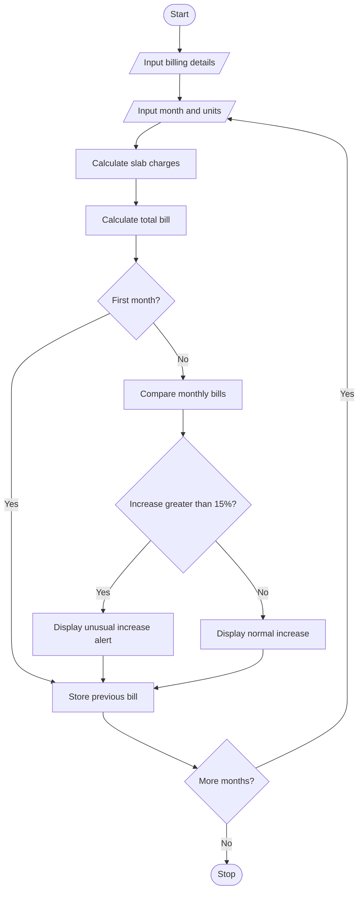

Title
Progressive Electricity Billing System Using Python

 Objective
To calculate electricity bills using progressive consumption
slabs, fixed charges, surcharges, and rebates, and to identify
unusual increases by comparing monthly bills.

Problem Statement
Develop a Python program that calculates household electricity
bills using different unit rates. The program must calculate
the total bill and compare it with the previous month's bill
to detect increases greater than 15%.

Algorithm
1. Start.
2. Input the number of months.
3. Input fixed charges, surcharge rate, and rebate.
4. Input the month name and units consumed.
5. Calculate energy charges using progressive slabs.
6. Calculate surcharge and total bill.
7. Display the bill details.
8. Compare the bill with the previous month's bill.
9. If the increase exceeds 15%, display an alert.
10. Repeat for all months.
11. Stop.

Flowchart


 Tariff Slabs

| Consumption | Rate |
|---|---:|
| First 100 units | Rs. 2 per unit |
| 101-200 units | Rs. 3 per unit |
| 201-300 units | Rs. 5 per unit |
| Above 300 units | Rs. 7 per unit |

Note: These rates are illustrative.

Sample Input

```text
Enter number of months: 2
Enter fixed charge: 75
Enter surcharge rate (%): 5
Enter rebate: 0

Enter month name: May
Enter units consumed: 180

Enter month name: June
Enter units consumed: 320
```

 Sample Output

```text
Month: May
Energy charges: Rs. 440.0
Fixed charges: Rs. 75.0
Surcharge: Rs. 25.75
Rebate: Rs. 0.0
Total bill: Rs. 540.75

Month: June
Energy charges: Rs. 1140.0
Fixed charges: Rs. 75.0
Surcharge: Rs. 60.75
Rebate: Rs. 0.0
Total bill: Rs. 1275.75
Bill change: 135.95 %
ALERT: Unusual bill increase!

Billing analysis completed.
```

 Result
The program calculates electricity bills using progressive
slabs and detects unusual increases by comparing monthly bills.
 Conclusion
This activity demonstrates the use of Python functions,
conditional statements, loops, arithmetic operations, and
real-world problem-solving.

