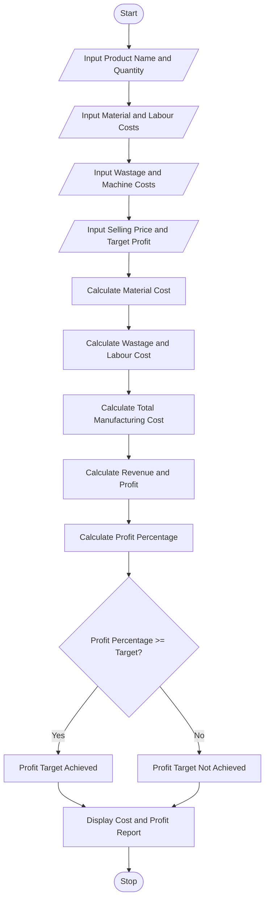

 Title
Manufacturing Cost and Profitability Analysis Using Python

 Aim
To develop a Python program to calculate manufacturing
costs, including material costs, labour charges, wastage,
and machine costs, and determine whether production
achieves the specified profit target.

 Problem Statement
Develop a Python program to calculate total manufacturing
cost, cost per unit, total revenue, profit or loss, and
profit percentage. The program should identify whether
the production meets the specified profit target.

 Algorithm

1. Start the program.
2. Enter product name and production quantity.
3. Enter material cost per unit.
4. Enter labour cost per unit.
5. Enter wastage percentage.
6. Enter machine cost.
7. Enter selling price per unit.
8. Enter target profit percentage.
9. Calculate total material cost.
10. Calculate wastage cost.
11. Calculate total labour cost.
12. Calculate total manufacturing cost.
13. Calculate cost per unit and total revenue.
14. Calculate profit or loss.
15. Calculate profit percentage.
16. Compare actual profit with target profit.
17. Display the manufacturing cost report.
18. Stop the program.

Flowchart



Formulae Used

1. Material Cost = Material Cost per Unit * Quantity

2. Wastage Cost = Material Cost * Wastage Percentage / 100

3. Labour Cost = Labour Cost per Unit * Quantity

4. Total Manufacturing Cost = Material Cost + Wastage Cost + Labour Cost + Machine Cost

5. Cost Per Unit = Total Manufacturing Cost / Quantity

6. Total Revenue = Selling Price per Unit * Quantity

7. Profit = Total Revenue - Total Manufacturing Cost

8. Profit Percentage = (Profit / Total Manufacturing Cost) * 100

 Sample Input

```text
Enter Product Name: Chair
Enter Production Quantity: 100
Enter Material Cost per Unit: 500
Enter Labour Cost per Unit: 150
Enter Wastage Percentage: 5
Enter Total Machine Cost: 5000
Enter Selling Price per Unit: 900
Enter Target Profit Percentage: 20
```

 Sample Output

```text
======================================
  MANUFACTURING COST REPORT
======================================
Product Name        : Chair
Production Quantity : 100
--------------------------------------
Material Cost       : Rs. 50000.0
Wastage Cost        : Rs. 2500.0
Labour Cost         : Rs. 15000.0
Machine Cost        : Rs. 5000.0
--------------------------------------
Total Production Cost: 72500.0
Cost Per Unit       : Rs. 725.0
Total Revenue       : Rs. 90000.0
Profit / Loss       : Rs. 17500.0
Profit Percentage   : 24.14 %
Target Profit       : 20.0 %
--------------------------------------
RESULT: PROFIT TARGET ACHIEVED
======================================
  ANALYSIS COMPLETED
```

 Result
The Python program successfully calculates material
costs, labour charges, wastage costs, machine costs,
total manufacturing costs, revenue and profit percentage.
It also identifies whether the specified profit target
is achieved.

 Conclusion
This activity demonstrates the use of Python variables,
arithmetic operators, conditional statements and
input/output functions to solve a real-world manufacturing
cost and profitability problem.


<badge color="success">Ready for submission</badge>

**Important:** Never paste Python code into `code.md`. Keep the Python program in `code.py` and documentation in `code.md`.
