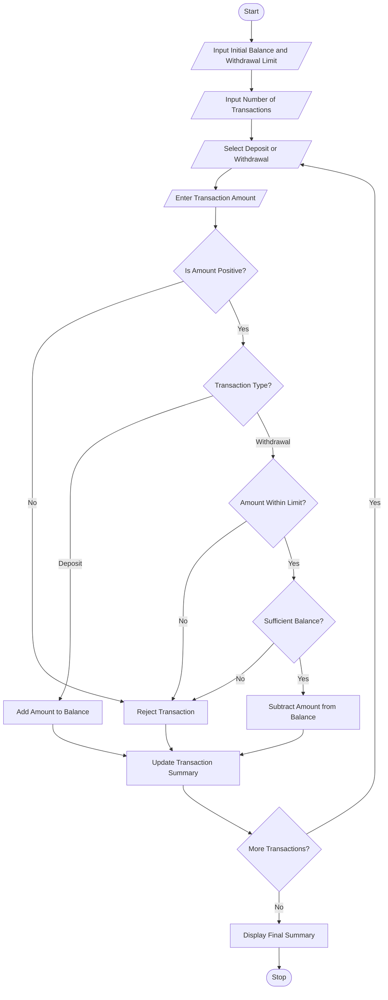

 Title
ATM Transaction Sequence Simulation Using Python

Aim
To develop a Python program to simulate ATM transactions
by processing deposits and withdrawals, maintaining account
balance, enforcing withdrawal limits, rejecting invalid
transactions, and generating a transaction summary.

Problem Statement
Develop a Python program that accepts an initial account
balance and processes multiple ATM transactions. The
program should allow deposits and withdrawals, check
available balance, enforce withdrawal limits, reject
invalid transactions, and display the final account balance.

 Algorithm

1. Start the program.
2. Enter the initial account balance.
3. Enter the maximum withdrawal limit.
4. Enter the number of transactions.
5. Select Deposit or Withdrawal.
6. Enter the transaction amount.
7. Check whether the amount is valid.
8. If it is a deposit, add the amount to the balance.
9. If it is a withdrawal, check available balance
   and withdrawal limit.
10. Accept or reject the transaction.
11. Update the account balance.
12. Repeat until all transactions are completed.
13. Display total deposits and withdrawals.
14. Display rejected transactions and final balance.
15. Stop the program.

Flowchart



 Rules Used

1. Deposit is accepted if the amount is positive.
2. Withdrawal must not exceed the withdrawal limit.
3. Withdrawal must not exceed available balance.
4. Zero and negative amounts are rejected.
5. Invalid transaction types are rejected.

Sample Input

```text
Enter Initial Balance: Rs. 10000
Enter Withdrawal Limit: Rs. 4000
Enter Number of Transactions: 5

Transaction 1
Enter D for Deposit or W for Withdrawal: D
Enter Amount: Rs. 2000

Transaction 2
Enter D for Deposit or W for Withdrawal: W
Enter Amount: Rs. 1500

Transaction 3
Enter D for Deposit or W for Withdrawal: W
Enter Amount: Rs. 6000

Transaction 4
Enter D for Deposit or W for Withdrawal: W
Enter Amount: Rs. 3500

Transaction 5
Enter D for Deposit or W for Withdrawal: D
Enter Amount: Rs. 500
```
 Sample Output

```text
--- ATM TRANSACTION PROCESSING ---

Transaction 1
Deposit Successful!
Current Balance: Rs. 12000.0

Transaction 2
Withdrawal Successful!
Current Balance: Rs. 10500.0

Transaction 3
Transaction Rejected: Limit Exceeded
Current Balance: Rs. 10500.0

Transaction 4
Withdrawal Successful!
Current Balance: Rs. 7000.0

Transaction 5
Deposit Successful!
Current Balance: Rs. 7500.0

====================================
       ATM TRANSACTION SUMMARY
====================================
Total Deposits      : Rs. 2500.0
Total Withdrawals   : Rs. 5000.0
Rejected Transactions: 1
Final Balance       : Rs. 7500.0
====================================
      TRANSACTION COMPLETED
```
 Result
The Python program successfully simulates ATM transactions
by processing deposits and withdrawals, maintaining account
balance, enforcing withdrawal limits, rejecting invalid
transactions, and generating a transaction summary.

Conclusion
This activity demonstrates the use of Python variables,
loops, conditional statements, arithmetic operators, and
input/output functions to solve a real-world banking problem

3. Your final folder structure

Your project folder should look like this:

<box border radius="lg" padding={3} gap={3}>
  <row align="center" gap={2}>
    <icon name="folder-open" color="#D6A343" size="xl"/>
    **ATM_Transaction_Simulation**
  </row>
  <box padding={{left:4}} gap={3}>
    <row align="center" gap={2}>
      <icon name="file-code" color="#438BD5" size="xl"/>
      **code.py**
      <spacer/>
      <badge color="info">Python code</badge>
    </row>
    <row align="center" gap={2}>
      <icon name="file-text" color="#269B70" size="xl"/>
      **code.md**
      <spacer/>
      <badge color="success">ABL documentation</badge>
    </row>
  </box>
</box>

 4. How to run your program

1. Open VS Code.
2. Open `code.py`.
3. Click the Run Python button.
4. Enter the sample input values.
5. Check the output in the terminal.
6. Open `code.md` to view your documentation.

<badge color="success">Ready for ABL submission</badge>

**Remember:**
- Copy only Python code into `code.py`.
- Copy only Markdown documentation into `code.md`.
- Save both files in the same folder.
