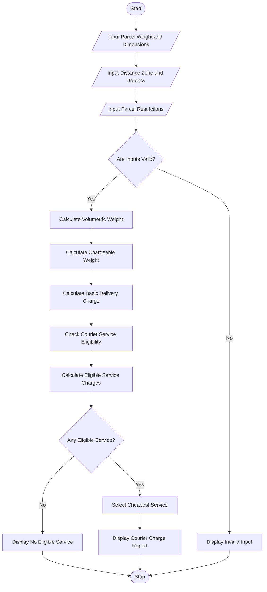

 Title
Courier Charge Optimization Using Python

 Aim
To develop a Python program to calculate courier
delivery charges based on parcel weight, dimensions,
distance zones, urgency, and restrictions, compare
different courier services, and select the cheapest
eligible service.

Problem Statement
Develop a Python program to calculate courier charges
based on parcel details and delivery requirements.
The program should calculate volumetric weight,
determine chargeable weight, check service eligibility,
compare delivery charges, and recommend the most
economical courier service.

 Algorithm

1. Start the program.
2. Enter parcel weight.
3. Enter parcel length, width, and height.
4. Enter distance zone.
5. Enter delivery urgency.
6. Enter parcel restriction details.
7. Validate the entered information.
8. Calculate volumetric weight.
9. Calculate chargeable weight.
10. Calculate basic delivery charges.
11. Check eligibility of courier services.
12. Calculate charges for eligible services.
13. Compare all eligible service charges.
14. Select the cheapest eligible service.
15. Display the courier charge report.
16. Stop the program.

Flowchart


 Formulae Used

1. Volumetric Weight = Length * Width * Height / 5000

2. Chargeable Weight = Maximum of Actual Weight
   and Volumetric Weight

3. Basic Charge = Chargeable Weight * Zone Rate

4. Service Charge = Basic Charge * Service Factor

Distance Zone Rates

| Distance Zone | Rate per kg |
|---|---:|
| Local | Rs. 30 |
| National | Rs. 60 |
| International | Rs. 150 |

 Courier Service Rules

| Service | Maximum Weight | Service Factor |
|---|---:|---:|
| Standard | 20 kg | 1.0 |
| Express | 10 kg | 1.5 |
| Special Handling | 30 kg | 2.0 |

Standard and Express services do not accept restricted
parcels. Special Handling accepts restricted parcels.
Standard service is not available for Express urgency.

 Sample Input

```text
Enter Parcel Weight (kg): 5
Enter Length (cm): 40
Enter Width (cm): 30
Enter Height (cm): 20
Enter Distance Zone (Local/National/International): National
Enter Urgency (Normal/Express): Normal
Does parcel contain restricted items? (yes/no): no
```

 Sample Output

```text
======================================
       COURIER SERVICE REPORT
======================================
Actual Weight       : 5.0 kg
Volumetric Weight   : 4.8 kg
Chargeable Weight   : 5.0 kg
Distance Zone       : National
Delivery Urgency    : Normal
--------------------------------------
SERVICE COMPARISON
--------------------------------------
Standard : Rs. 300.0
Express : Rs. 450.0
Special Handling : Rs. 600.0
--------------------------------------
Recommended Service : Standard
Minimum Courier Fee : Rs. 300.0
======================================
       ANALYSIS COMPLETED
```

 Result
The Python program successfully calculates courier
charges based on parcel weight, dimensions, distance
zones, urgency, and restrictions. It compares courier
services and recommends the cheapest eligible service.

Conclusion
This activity demonstrates the use of Python variables,
dictionaries, loops, conditional statements, arithmetic
operators, and built-in functions to solve a real-world
courier charge optimization problem.


Your project should look like this:

<box border radius="lg" padding={3} gap={3}>
  <row align="center" gap={2}>
    <icon name="folder-open" color="#D6A343" size="xl"/>
    **Courier_Charge_Optimization**
  </row>
  <box padding={{left:4}} gap={3}>
    <row align="center" gap={2}>
      <icon name="file-code" color="#438BD5" size="xl"/>
      **code.py**
      <spacer/>
      <badge color="info">Python code</badge>
    </row>
    <row align="center" gap={2}>
      <icon name="file-text" color="#269B70" size="xl"/>
      **code.md**
      <spacer/>
      <badge color="success">ABL report</badge>
    </row>
  </box>
</box>

