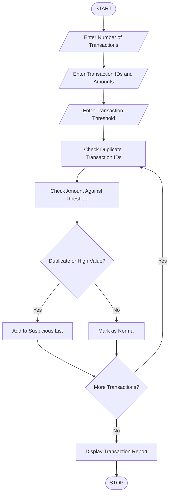

Title
Repeated Transaction Detection Using Python
 1. Aim
To develop a Python program to process transaction
identifiers and amounts, detect duplicate transactions,
identify transactions exceeding a specified threshold,
and generate a list of suspicious entries.

2. Problem Statement
A bank wants to develop a transaction monitoring
system to identify suspicious financial activities.

The program accepts multiple transaction IDs and
their corresponding amounts. It identifies duplicate
transaction IDs, detects transactions exceeding a
specified amount limit, and generates a suspicious
transaction report.
 3. Algorithm

1. Start the program.
2. Enter the number of transactions.
3. Enter transaction ID and amount for each transaction.
4. Store transaction details in a list.
5. Enter the maximum transaction threshold.
6. Initialize an empty list for suspicious transactions.
7. Check transaction IDs for duplicates.
8. Check whether transaction amounts exceed the threshold.
9. Mark duplicate and high-value transactions as suspicious.
10. Store suspicious transaction details.
11. Display all transactions.
12. Display duplicate transaction IDs.
13. Display high-value transactions.
14. Display suspicious transactions.
15. Stop the program.

 4. Flowchart



 5. Rules Used

1. If a transaction ID occurs more than once,
   it is identified as a duplicate.
2. If the transaction amount exceeds the threshold,
   it is identified as a high-value transaction.
3. Duplicate or high-value transactions are marked
   as suspicious.
4. Other transactions are treated as normal.

 6. Sample Input

```text
Enter Number of Transactions: 5

Transaction 1
Enter Transaction ID: T101
Enter Transaction Amount: Rs. 2000

Transaction 2
Enter Transaction ID: T102
Enter Transaction Amount: Rs. 5000

Transaction 3
Enter Transaction ID: T101
Enter Transaction Amount: Rs. 3000

Transaction 4
Enter Transaction ID: T103
Enter Transaction Amount: Rs. 15000

Transaction 5
Enter Transaction ID: T104
Enter Transaction Amount: Rs. 1000

Enter Transaction Threshold: Rs. 10000
```

7. Sample Output

```text
======================================
       TRANSACTION ANALYSIS REPORT
======================================

All Transactions:
ID: T101 | Amount: Rs. 2000.0
ID: T102 | Amount: Rs. 5000.0
ID: T101 | Amount: Rs. 3000.0
ID: T103 | Amount: Rs. 15000.0
ID: T104 | Amount: Rs. 1000.0

Duplicate Transaction IDs:
T101

High Value Transactions:
T103 - Rs. 15000.0

Suspicious Transactions:
ID: T101
Amount: Rs. 2000.0
Reason: Duplicate Transaction ID
----------------------------------
ID: T101
Amount: Rs. 3000.0
Reason: Duplicate Transaction ID
----------------------------------
ID: T103
Amount: Rs. 15000.0
Reason: Amount Exceeds Threshold
----------------------------------
======================================
       ANALYSIS COMPLETED
```

 8. Result

The Python program successfully processes transaction
identifiers and amounts, detects duplicate transactions,
identifies threshold violations, and generates a list
of suspicious transactions.

9. Conclusion

This activity demonstrates the use of Python lists,
dictionaries, loops, conditional statements, and string
operations to identify suspicious financial transactions.
                                                                                                                                                                10. Viva Questions

1. What is a transaction ID?
2. What is duplicate transaction detection?
3. What is a transaction threshold?
4. What is a Python list?
5. What is a Python dictionary?
6. What is the purpose of the count() function?
7. How does the program identify duplicate IDs?
8. What is the difference between normal and suspicious transactions?
```

 3. Final folder structure

Your project folder should look like this:

<box border radius="lg" padding={3} gap={3}>
  <row align="center" gap={2}>
    <icon name="folder-open" color="#D6A343" size="xl"/>
    **Repeated_Transaction_Detection**
  </row>
  <box padding={{left:4}} gap={3}>
    <row align="center" gap={2}>
      <icon name="file-code" color="#438BD5" size="xl"/>
      **code.py**
      <spacer/>
      <badge color="info">Python code</badge>
    </row>
    <row align="center" gap={2}>
      <icon name="file-text" color="#269B70" size="xl"/>
      **code.md**
      <spacer/>
      <badge color="success">ABL documentation</badge>
    </row>
  </box>
</box>
 4. How to run the program

1. Open VS Code.
2. Open the `code.py` file.
3. Open the terminal.
4. Execute this command:

```bash
python code.py
```

5. Enter the sample input values.
6. Compare your result with the sample output.

<badge color="success">Ready for submission</badge>

**Remember:**
- `code.py` → Paste only Python source code.
- `code.md` → Paste only ABL documentation.
- Save both files in the same folder.

*Note: This is an educational transaction-monitoring program. A suspicious transaction is flagged for review; it does not automatically prove fraud.*
