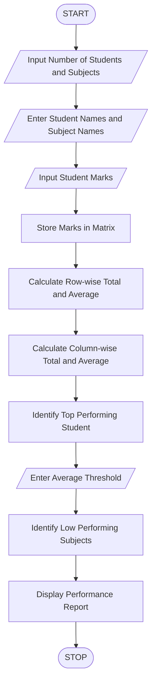

Title
Student Marks Matrix Analysis Using Python
 1. Aim
To develop a Python program to analyse a matrix of
student marks across different subjects, calculate
row-wise and column-wise statistics, identify top
performers, and detect subjects with low average marks.

 2. Problem Statement
Develop a Python program to analyse student academic
performance using a two-dimensional marks matrix.

The program should calculate student-wise totals and
averages, subject-wise totals and averages, identify
the top-performing student, and detect subjects with
low average performance.

 3. Algorithm

1. Start the program.
2. Enter the number of students and subjects.
3. Enter student names.
4. Enter subject names.
5. Input marks of every student in each subject.
6. Store marks in a two-dimensional list.
7. Calculate row-wise total and average marks.
8. Calculate column-wise total and average marks.
9. Identify the top-performing student.
10. Enter the minimum subject average threshold.
11. Identify subjects with averages below the threshold.
12. Display the student-wise statistics.
13. Display the subject-wise statistics.
14. Display the top-performing student.
15. Display low-performing subjects.
16. Stop the program.

 4. Flowchart



5. Formulae Used

Student Total = Sum of marks in each row

Student Average = Student Total / Number of Subjects

Subject Total = Sum of marks in each column

Subject Average = Subject Total / Number of Students

Top Performer = Student with highest average marks

6. Sample Input

```text
Enter Number of Students: 4
Enter Number of Subjects: 3

Enter Student Name: Ravi
Enter Student Name: Priya
Enter Student Name: Arun
Enter Student Name: Sneha

Enter Subject Name: Python
Enter Subject Name: Mathematics
Enter Subject Name: Physics

Marks for Ravi
Python: 85
Mathematics: 75
Physics: 80

Marks for Priya
Python: 90
Mathematics: 95
Physics: 92

Marks for Arun
Python: 45
Mathematics: 50
Physics: 55

Marks for Sneha
Python: 70
Mathematics: 65
Physics: 75

Enter Minimum Subject Average Threshold:
70
```

7. Sample Output

```text
========================================
       STUDENT PERFORMANCE REPORT
========================================

STUDENT-WISE ANALYSIS
Ravi Total: 240.0 Average: 80.0
Priya Total: 277.0 Average: 92.33
Arun Total: 150.0 Average: 50.0
Sneha Total: 210.0 Average: 70.0

SUBJECT-WISE ANALYSIS
Python Total: 290.0 Average: 72.5
Mathematics Total: 285.0 Average: 71.25
Physics Total: 302.0 Average: 75.5

TOP PERFORMING STUDENT(S):
Priya
Highest Average: 92.33

LOW-PERFORMING SUBJECTS:
No Low-Performing Subjects

========================================
       ANALYSIS COMPLETED
========================================
```

8. Result
The Python program successfully analyses the student
marks matrix, calculates student-wise and subject-wise
statistics, identifies the top-performing student,
and detects subjects with low average performance.

 9. Conclusion
This activity demonstrates the use of Python
two-dimensional lists, nested loops, conditional
statements, arithmetic operators, and built-in
functions to analyse student academic performance.


 3. Final folder structure

Your project folder should look like this:

<box border radius="lg" padding={3} gap={3}>
  <row align="center" gap={2}>
    <icon name="folder-open" color="#D6A343" size="xl"/>
    **Student_Marks_Analysis**
  </row>
  <box padding={{left:4}} gap={3}>
    <row align="center" gap={2}>
      <icon name="file-code" color="#438BD5" size="xl"/>
      **code.py**
      <spacer/>
      <badge color="info">Python program</badge>
    </row>
    <row align="center" gap={2}>
      <icon name="file-text" color="#269B70" size="xl"/>
      **code.md**
      <spacer/>
      <badge color="success">ABL documentation</badge>
    </row>
  </box>
</box>
