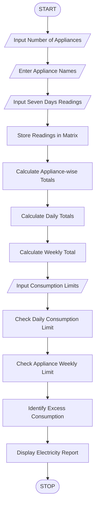

 Title
Weekly Electricity Consumption Matrix Using Python

 1. Aim
To develop a Python program to process appliance-wise
electricity readings across seven days, calculate daily
and appliance totals, and identify consumption
exceeding specified limits.

2. Problem Statement
A household wants to monitor electricity consumption
of different appliances over seven days.

The program accepts electricity readings for different
appliances, stores the readings in a matrix, calculates
daily and appliance-wise totals, and identifies
consumption exceeding specified limits.

3. Algorithm

1. Start the program.
2. Enter the number of appliances.
3. Enter appliance names.
4. Input electricity readings for seven days.
5. Store readings in a two-dimensional matrix.
6. Calculate appliance-wise weekly consumption.
7. Calculate daily electricity consumption.
8. Calculate total weekly consumption.
9. Enter daily and appliance consumption limits.
10. Identify days exceeding the daily limit.
11. Identify appliances exceeding the weekly limit.
12. Display the electricity consumption report.
13. Stop the program.

 4. Flowchart



5. Formulae Used

Appliance Total = Sum of Seven Daily Readings

Daily Total = Sum of All Appliance Readings for One Day

Weekly Total = Sum of Seven Daily Totals

Daily Violation = Daily Total > Daily Limit

Appliance Violation = Appliance Total > Weekly Limit

 6. Sample Input

```text
Enter Number of Appliances: 3

Enter Appliance Name: Fan
Enter Appliance Name: AC
Enter Appliance Name: Refrigerator

Appliance: Fan
Monday: 2
Tuesday: 2
Wednesday: 2
Thursday: 2
Friday: 2
Saturday: 3
Sunday: 3

Appliance: AC
Monday: 5
Tuesday: 6
Wednesday: 7
Thursday: 6
Friday: 5
Saturday: 8
Sunday: 8

Appliance: Refrigerator
Monday: 3
Tuesday: 3
Wednesday: 3
Thursday: 3
Friday: 3
Saturday: 3
Sunday: 3

Enter Daily Consumption Limit (kWh): 12
Enter Weekly Appliance Limit (kWh): 35
```

 7. Sample Output

```text
======================================
 WEEKLY ELECTRICITY REPORT
======================================

APPLIANCE-WISE CONSUMPTION
Fan : 16.0 kWh
AC : 45.0 kWh
Refrigerator : 21.0 kWh

DAILY CONSUMPTION
Monday : 10.0 kWh
Tuesday : 11.0 kWh
Wednesday : 12.0 kWh
Thursday : 11.0 kWh
Friday : 10.0 kWh
Saturday : 14.0 kWh
Sunday : 14.0 kWh

TOTAL WEEKLY CONSUMPTION: 82.0 kWh

DAYS EXCEEDING DAILY LIMIT
Saturday : 14.0 kWh
Sunday : 14.0 kWh

APPLIANCES EXCEEDING WEEKLY LIMIT
AC : 45.0 kWh

======================================
 ANALYSIS COMPLETED
======================================
```

8. Result
The Python program successfully calculates daily,
appliance-wise, and total weekly electricity consumption.
It also identifies days and appliances exceeding
the specified consumption limits.

 9. Conclusion
This activity demonstrates the use of Python lists,
two-dimensional matrices, nested loops, conditional
statements, and built-in functions for household
electricity consumption analysis.

 10. Viva Questions

1. What is a two-dimensional list in Python?
2. What is appliance-wise consumption?
3. What is daily electricity consumption?
4. What is row-wise calculation?
5. What is column-wise calculation?
6. What is the purpose of nested loops?
7. What is the use of the sum() function?
8. What is a consumption threshold?
9. What is the unit of electrical energy?
10. How can Python help in energy management?
```
