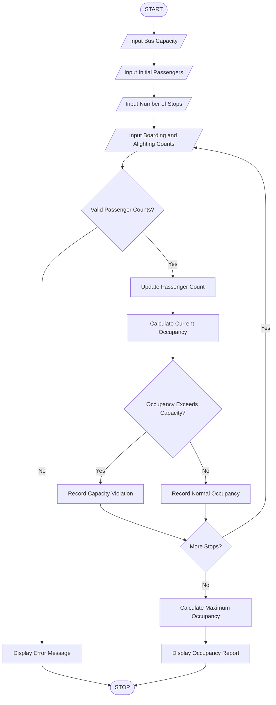

Title
Bus Passenger Occupancy Simulation Using Python

 1. Aim
To develop a Python program to simulate bus passenger
occupancy by processing boarding and alighting counts
across multiple stops, calculating passenger counts
at each stop, and identifying capacity violations.

 2. Problem Statement
A bus travels through multiple stops where passengers
board and alight at each stop.

The program accepts bus capacity, initial passenger
count, boarding count, and alighting count at every stop.
It calculates passenger occupancy and identifies
stops where passenger capacity is exceeded.

 3. Algorithm

1. Start the program.
2. Enter maximum bus capacity.
3. Enter initial passenger count.
4. Enter the number of bus stops.
5. Initialize an occupancy list.
6. Input boarding and alighting counts at each stop.
7. Validate passenger counts.
8. Subtract alighting passengers from current passengers.
9. Add boarding passengers to current passengers.
10. Calculate the passenger count after each stop.
11. Check whether passenger count exceeds bus capacity.
12. Record capacity violations.
13. Calculate maximum occupancy.
14. Display the bus occupancy report.
15. Stop the program.

 4. Flowchart



 5. Formulae Used

Passengers After Alighting =
Previous Passengers - Alighting Passengers

Current Passengers =
Previous Passengers - Alighting Passengers
+ Boarding Passengers

Capacity Violation =
Current Passengers > Maximum Bus Capacity

Maximum Occupancy =
Maximum passenger count recorded at all stops.

6. Sample Input

```text
Enter Maximum Bus Capacity: 50
Enter Initial Number of Passengers: 20
Enter Number of Bus Stops: 5

Bus Stop 1
Enter Alighting Passengers: 5
Enter Boarding Passengers: 15

Bus Stop 2
Enter Alighting Passengers: 3
Enter Boarding Passengers: 10

Bus Stop 3
Enter Alighting Passengers: 4
Enter Boarding Passengers: 20

Bus Stop 4
Enter Alighting Passengers: 2
Enter Boarding Passengers: 15

Bus Stop 5
Enter Alighting Passengers: 10
Enter Boarding Passengers: 5
```

 7. Sample Output

```text
======================================
       BUS OCCUPANCY REPORT
======================================

Stop 1 - Passengers: 30
Status: Within Capacity

Stop 2 - Passengers: 37
Status: Within Capacity

Stop 3 - Passengers: 53
WARNING: CAPACITY EXCEEDED

Stop 4 - Passengers: 66
WARNING: CAPACITY EXCEEDED

Stop 5 - Passengers: 61
WARNING: CAPACITY EXCEEDED

--------------------------------------
Maximum Occupancy: 66
Bus Capacity: 50

CAPACITY VIOLATIONS:
Stop 3 - Passengers: 53
Stop 4 - Passengers: 66
Stop 5 - Passengers: 61

======================================
       SIMULATION COMPLETED
======================================
```

 8. Result
The Python program successfully simulates bus
passenger occupancy across multiple stops, calculates
passenger counts after boarding and alighting, and
identifies capacity violations.

 9. Conclusion
This activity demonstrates the use of Python variables,
lists, loops, conditional statements, arithmetic
operators, and built-in functions to simulate a
real-world public transportation system.

3. Final folder structure

Your project folder should look like this:

<box border radius="lg" padding={3} gap={3}>
  <row align="center" gap={2}>
    <icon name="folder-open" color="#D6A343" size="xl"/>
    **Bus_Passenger_Occupancy**
  </row>
  <box padding={{left:4}} gap={3}>
    <row align="center" gap={2}>
      <icon name="file-code" color="#438BD5" size="xl"/>
      **code.py**
      <spacer/>
      <badge color="info">Python code</badge>
    </row>
    <row align="center" gap={2}>
      <icon name="file-text" color="#269B70" size="xl"/>
      **code.md**
      <spacer/>
      <badge color="success">Documentation</badge>
    </row>
  </box>
</box>

